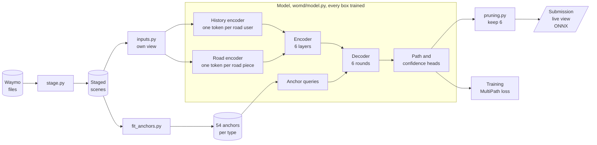

# MotionNet

A Python program that predicts where cars, cyclists and pedestrians
will move next, from recorded autonomous-driving data.

A Waymo car records the scene around it: where each road user has been
for the past second, the lane lines, the state of the traffic lights.
From that one second, this program predicts the next eight: six
possible paths per road user, each with a confidence. A car approaching
a junction may turn or continue straight, and a single prediction would
average the two.

## Results

minADE: the mean distance, in metres, between the recorded path and the
closest of the six predictions. Lower is better.

| minADE (m)                | 3 s  | 5 s  | 8 s   |
|---------------------------|------|------|-------|
| cars, validation          | 0.36 | 0.77 | 1.49  |
| cars, test                | 0.36 | 0.77 | 1.49  |
| cars, control             | 2.33 | 5.47 | 10.98 |
| pedestrians, validation   | 0.19 | 0.37 | 0.65  |
| pedestrians, test         | 0.19 | 0.37 | 0.65  |
| pedestrians, control      | 0.47 | 0.89 | 1.55  |
| cyclists, validation      | 0.38 | 0.73 | 1.30  |
| cyclists, test            | 0.37 | 0.73 | 1.31  |
| cyclists, control         | 1.14 | 2.26 | 4.17  |

Validation: 44,097 scenes, scored by Waymo's metric code and confirmed
by Waymo's evaluation server. Test: 44,920 scenes, graded by the server
only. Control: constant speed and heading. Training: a quarter of the
training split, 122,352 scenes, 16 epochs, two 12-hour sessions on a
free Kaggle GPU. Not comparable to the public leaderboard.

## Method

1. Waymo's files are read with TensorFlow's record reader and reduced
   to numeric arrays, one file per scene. (`stage.py`,
   `womd/store.py`)
2. Before training, the endpoints of the training paths are clustered
   into 54 typical destinations per road-user type: straight and far,
   gentle left, hard right. These are the anchors. (`fit_anchors.py`)
3. A transformer encodes the scene and, for each anchor, adjusts that
   anchor's path to fit it. A second head scores how likely each anchor
   is. The loss is the paper's (MultiPath, Chai et al. 2019): each
   training example trains the path of the anchor closest to the
   recorded path, and trains the confidence toward that same anchor.
   (`womd/model.py`, `womd/loss.py`, `train.py`)
4. At prediction time the 54 are ranked by confidence, near-duplicates
   are dropped, and the six highest are kept. (`womd/pruning.py`,
   `submit.py`)
5. The whole path from a scene to its six kept paths exports as one
   ONNX graph, checked against PyTorch. (`export_onnx.py`)

The exact inputs the model reads are drawn, column by column, at the
bottom of `womd/contract.py`.

## Architecture



## Usage

Waymo does not permit redistribution of their data, so reproducing the
table requires a Waymo Open Motion Dataset account; `stage.py` converts
their files into this repository's format.

```
make test      # run the test suite, under 30 seconds
make stage     # turn raw WOMD shards into one .npz per scene
make train     # train, resuming from the checkpoint if one exists
make export    # export to ONNX, check it against PyTorch, time both
make live      # play staged scenes with live predictions
```

To watch, open Lichtblick, import `lichtblick_layout.json` from the
Layouts tab, run `make live`, then choose Open connection, Foxglove
WebSocket and `ws://127.0.0.1:8765`.

## References

The scene encoder follows VectorNet (Gao et al., CVPR 2020). The
decoder's anchor queries match MTR (Shi et al., NeurIPS 2022).
